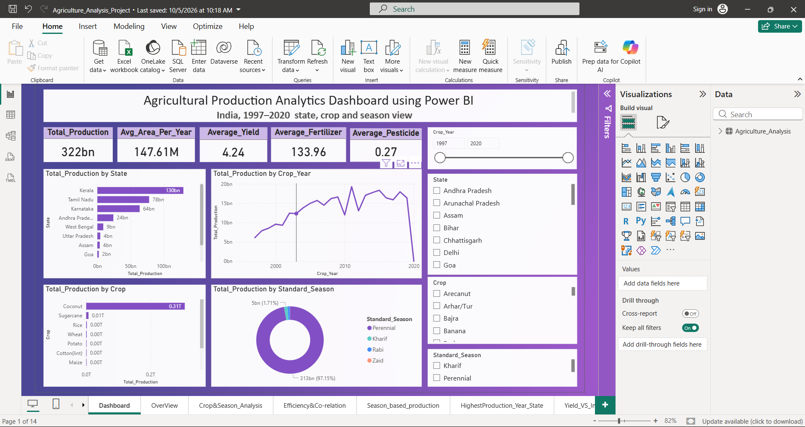

# 🌾 Agricultural Production Analytics Dashboard (Power BI)

An interactive Power BI dashboard that analyzes crop production in India from **1997 to 2020**. It explores how area, rainfall, fertilizer, pesticide use, and yield relate to production across states, crops, and seasons.



## 📌 Project Overview

| Metric | Value |
|---|---|
| Records | ~19,700 |
| Unique crops | 55 |
| Crop years | 24 (1997-2020) |
| Seasons | 4 (Kharif, Rabi, Zaid, Whole Year/Perennial) |
| Dashboard pages | 14 |
| Analytical objectives | 8 |

## 🎯 Objectives

1. Season-wise production: which season contributes the most and the least
2. Best year and state combination, with the rainfall that year
3. Yield vs. input efficiency (fertilizer and pesticide)
4. Top 10 states by production
5. Top 10 crops by production
6. Top 2 seasons by production
7. Top 10 crops in the 2000-2020 window
8. State-wise comparison of area, rainfall, and input use

## 📊 Dashboard Features

- **KPI cards:** Total Production, Average Area per Year, Average Yield, Average Fertilizer, Average Pesticide
- **Visuals:** ranked bar charts, production trend line, season-share donut chart
- **Slicers:** Crop Year (range), State, Crop, Standard Season
- **Pages:** Dashboard, Overview, Crop & Season Analysis, Efficiency & Correlation, Season-based Production, Highest Production Year/State, Yield vs. Inputs, and more

## 🧹 Data Cleaning

- Handled the **coconut unit mismatch** (recorded in nuts, not tonnes) by excluding it from cross-crop comparisons
- Accounted for **incomplete 2020 data** (only 37 records)
- Created a `Standard_Season` field to group seasons consistently
- Checked for nulls, duplicates, and data type issues

## 🔍 Key Insights

- **Kerala, Tamil Nadu, and Karnataka** are the top 3 states by production; Kerala peaked in 2005 (rainfall 3,030.9 mm)
- **Kharif and Whole Year** crops contribute over **97%** of national production
- **Coconut and Sugarcane** lead nationally, and the ranking is stable across 2000-2020
- **Goa** has the highest average yield with modest fertilizer and pesticide use
- **Uttar Pradesh** has the highest fertilizer and pesticide consumption but does not lead in efficiency
- **Meghalaya** has the highest average rainfall (~4,043 mm) and **Haryana** the lowest (~467 mm)

## 💡 Recommendations

1. Use Kerala's input-efficiency practices as a national benchmark
2. Prioritize investment in Kharif and Whole Year crops
3. Run a targeted extension program for Chhattisgarh (lowest input efficiency)
4. Scale up Coconut and Sugarcane value chains
5. Reduce concentration risk in input supply to Uttar Pradesh
6. Build rainfall-resilience programs for low-rainfall states like Haryana
7. Use Goa as a best-practice case study for high yield with low inputs
8. Review resource allocation for Delhi and Puducherry

## 🛠️ Tech Stack

- **Power BI Desktop**
- **DAX** for measures and calculated columns
- **Power Query** for cleaning and transformation
- **Excel** as the data source

## 📁 Repository Structure

```
├── Agricultural_dataset.xlsx                              # Source dataset
├── Agri_project.pbix.zip                                  # Power BI report (zipped)
├── Agricultural_Production_Analytics_Project-final.pptx   # Presentation
├── Agricultural_Dashboard.png                             # Dashboard screenshot
└── README.md
```

## 🚀 How to Use

1. Clone or download the repo:
   `git clone https://github.com/shobanachandran24-lab/Agricultural-Production-Analytics-Dashboard-using-Power-BI.git`
2. **Unzip** `Agri_project.pbix.zip` to get the `.pbix` file
3. Open the `.pbix` file in Power BI Desktop
4. If prompted, point the data source to `Agricultural_dataset.xlsx`
5. Use the slicers to explore by year, state, crop, and season


## 👤 Author

**Shobana C**
[GitHub](https://github.com/shobanachandran24-lab) · [LinkedIn](https://www.linkedin.com/in/shobanachandran2402/)
